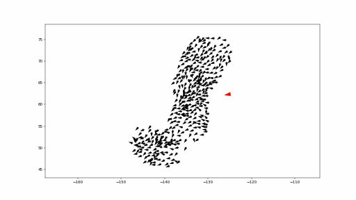

# Fish school predator dynamics

Group project for the Collective Behaviour course at the Faculty of Computer and Information Science, University of Ljubljana (2026/27).

## Starting point

Klamser & Romanczuk (2021). Collective predator evasion: Putting the criticality hypothesis to the test. PLoS Computational Biology. [doi:10.1371/journal.pcbi.1008832](https://doi.org/10.1371/journal.pcbi.1008832), [original code](https://github.com/PaPeK/PredatorPrey).

The paper simulates a 2D school of fish attacked by a predator. The predator catches the fewest fish when the school is halfway between disordered and fully aligned.



*One run of our Python model (alignment strength 2, seed 1), made with `python3 -m scripts.animate`.*

## Project description

We reimplement the model in Python and reproduce its main result. We then improve the predator with one behavioural change, such as its attack angle, and also test whether the result holds in 3D. Finally, we turn the predator into a shepherd that steers the school without breaking it apart, trying to adapt to fish the model of [Strömbom et al. (2014)](https://doi.org/10.1098/rsif.2014.0719) (a single sheepdog herding a flock of sheep).

## Plan / milestones

- Report 1 (13 Nov 2026): literature review, Python reimplementation, reproduction of the main result.
- Report 2 (11 Dec 2026): improved predator, 3D version of the model, comparison with the literature.
- Report 3 (8 Jan 2027): shepherd, compared with [Van Havermaet et al. (2024)](https://doi.org/10.1038/s41598-024-65894-5) (a group of robots that encircle a fish school to guide it); final report.

## Running the original C++ code

To read the reference implementation and compare our Python model with it.

```bash
sudo apt install libhdf5-dev libgsl-dev libcgal-dev libgmp-dev libboost-system-dev libboost-thread-dev
pip install h5py matplotlib
git clone https://github.com/PaPeK/PredatorPrey.git local/PredatorPrey
make -C local/PredatorPrey LFLAGS="-lgsl -lgslcblas -lm -lgmp -lboost_system -lboost_thread"
```

Quick comparison with the Python model, default parameters of the C++ code (runs are spread over all cores; one C++ run takes about 15 s):

```bash
mkdir -p results
python3 scripts/run_cpp.py local/PredatorPrey results/cpp.jsonl 0.5,1,2,5 4   # alignment strengths, runs per value
python3 scripts/compare_cpp.py results/cpp.jsonl results/py.jsonl 4            # same values in Python, prints a table
python3 scripts/plot_comparison.py results/cpp.jsonl results/py.jsonl results/comparison.png
```

Comparison used in report 1: the alignment sweep of the paper's Fig 2 with the parameters of table S1 (`--table-s1`: attack of 120 time units, attack rate 1/3), 40 C++ runs per alignment strength (about 45 min on 8 cores), against the Python sweep of `report/data/sweep_control.jsonl` (see below):

```bash
python3 scripts/run_cpp.py local/PredatorPrey report/data/cpp_sweep.jsonl 0,0.1,0.2,0.3,0.4,0.5,0.6,0.7,0.8,0.9,1,1.1,1.2,1.3,1.4,1.5,1.6 40 --table-s1
python3 -m scripts.plot_cpp_sweep   # Welch test per alignment strength, report/figures/cpp_comparison.pdf
```

C++ runs cannot be reproduced because the seed comes from the clock, so we compare means instead.

## Reproducing the main result

Capture rate and polarization against alignment strength, with the parameters of table S1 of the paper (Fig 2 at D = 0.5). Each run also attacks a copy of the school that does not flee (the control school of the paper), which gives the escape ratio R_esc = 1 − γc/γc,NF of Fig 2D, and records the structure of the school when the predator appears: inter-individual distance (mean over all pairs, inset of Fig 2C) and nearest-neighbour distance. Runs are spread over all cores (about 3 h for the command below on 8 cores) and an interrupted sweep restarts where it stopped.

```bash
python3 -m scripts.sweep_alignment results/sweep_control.jsonl 0:1.6:0.1 40   # alignment strengths 0 to 1.6, 40 runs each
python3 -m scripts.plot_sweep results/sweep_control.jsonl results/sweep_control.png    # prints a table and saves the figure
```

The sweep used in the reports, its figures and the numbers to quote are in [`report/`](report/RESULTS.md) (`python3 -m scripts.report_figures` redraws them).

## Team (Group F)

| Name | GitHub |
|------|--------|
| Mathieu Bonnet | [@mathieusharp](https://github.com/mathieusharp) |
| Loup Benois | [@loulliam](https://github.com/loulliam) |
| Alexandre Peret | [@Elysios05](https://github.com/Elysios05) |
