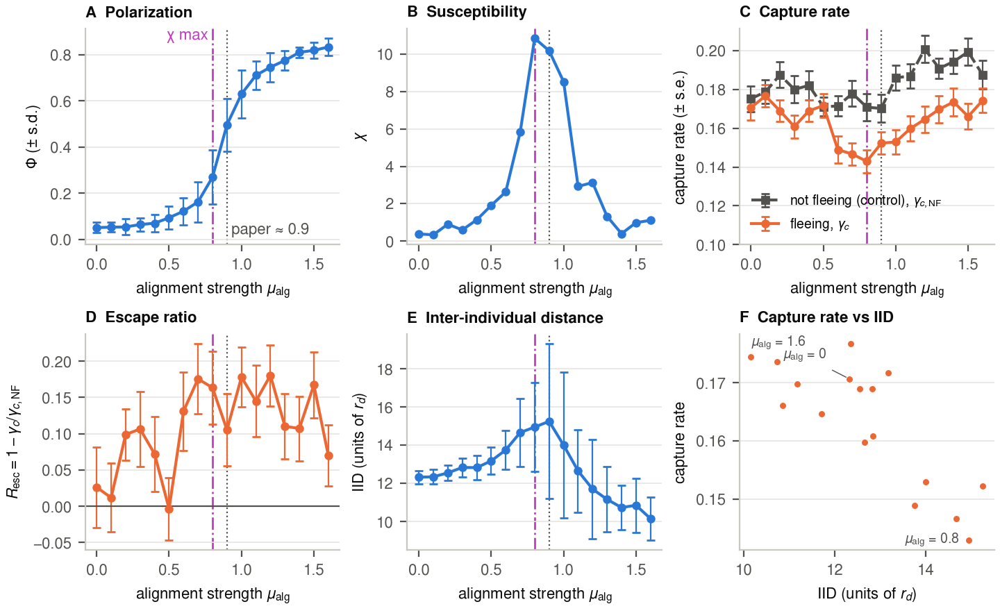

# Fish school predator dynamics

Group project for the Collective Behaviour course at the Faculty of Computer and Information Science, University of Ljubljana (2026/27).

**Report 1:** [`report/report.pdf`](report/report.pdf) (literature review, reimplementation, reproduction, plan).

## Starting point

Klamser & Romanczuk (2021). Collective predator evasion: Putting the criticality hypothesis to the test. PLoS Computational Biology. [doi:10.1371/journal.pcbi.1008832](https://doi.org/10.1371/journal.pcbi.1008832), [original code](https://github.com/PaPeK/PredatorPrey) (C++).

The paper simulates a 2D school of 400 fish attacked by one predator.

- **Prey.** Each fish swims at constant speed. It keeps a preferred distance to its neighbours, aligns with them, and flees when the predator is close. The alignment strength sets the state of the school: low alignment gives a disordered swarm, high alignment a polarized school, and between the two there is an order–disorder transition.
- **Predator.** It is twice as fast as the prey. It appears from an almost random direction, heads for the school, then for the prey in front of it, and catches prey with a probability that grows when it gets closer.
- **Main results.** The predator catches the fewest fish when the school is at the transition, halfway between disordered and fully aligned. This is not because the school escapes better there, but because it is more spread out. When the alignment strength of each fish is left to evolve, the fish end up far in the ordered phase: the transition is best for the group, but evolution does not keep it there.


*One run of our Python model with the default parameters of the C++ code (alignment strength 2, ordered school, seed 1), made with `mkdir -p results && python3 -m scripts.animate` (writes `results/run.gif`).*

## Research question

Is the order–disorder transition still special when the agent that perturbs the school changes? The paper shows that a school at the transition is caught least by one simple predator. We ask two questions:

1. Does this optimum hold for a more realistic predator, one that is confused by many prey or that intercepts its prey?
2. Does the transition also make it easiest for a single shepherd to move the school without breaking it?

We only change the agent and keep the prey rules of the paper.

## Approach

Each step changes only the agent that perturbs the school. This agent only uses local information (what it can see around it). Every step uses the same sweep over the alignment strength (0 to 1.6, at least 40 runs per value), so the results can be compared directly. The predators are also tested on the control school of the paper, which does not flee.

**1. Reproduction (report 1, done).** We rewrote the model in Python ([`predprey/`](predprey/)), checked it against the original C++ code, and reproduced the group optimum of the paper (Fig 2 at noise D = 0.5). See [Results so far](#results-so-far).

**2. Improved predator: confusion and interception (report 2).**

Our reproduction shows two effects. On the ordered side of the transition, the low capture rate comes from the structure of the school (it is more spread out). On the disordered side, it comes from fleeing. Each change of the predator targets one of them. Both predators only use the prey they can see.

| Change | What the predator does | Effect targeted | Expected |
|---|---|---|---|
| **Confusion** ([Olson et al., 2013](https://doi.org/10.1098/rsif.2013.0305); [Demšar et al., 2015](https://doi.org/10.1016/j.ecolmodel.2015.02.018)) | Its chance of making a catch decreases when many prey are within a confusion radius, counted among all the prey it sees (not only its Voronoi neighbours). In the original model this chance does not depend on their number. | Structure | Confusion protects dense schools, and ordered schools are the densest, so the minimum should move towards the ordered phase. |
| **Interception** | It heads for the predicted position of the prey it hunts (from their velocity) instead of their current position. | Fleeing | Fleeing prey are caught more easily, so the advantage of fleeing on the disordered side should shrink. |

- *Measure.* Capture rate and escape ratio against alignment strength, with the original predator as reference. Each change is first tested alone, then both together.
- *3D.* The comparison is then made in three dimensions: headings become 3D unit vectors (the code already stores directions as vectors, not angles) and neighbours are computed with a 3D Voronoi diagram. In 3D, the predator also chooses the direction of its attack, including from below or above. Drone videos of marlins attacking sardines show that the escape of the school ("fountain effect") depends on the attack direction ([Bartashevich et al., 2024](https://doi.org/10.1038/s42003-024-07267-2)). We check whether the capture-rate minimum is still at the transition in 3D.

**3. Shepherd (report 3, the most original part).**
- *What changes.* The predator no longer tries to catch fish. It tries to move the whole school to a target region without breaking it apart.
- *Why it is new.* [Strömbom et al. (2014)](https://doi.org/10.1098/rsif.2014.0719) solved this with a single sheepdog, but their sheep do not align with each other and stop when the dog is far. Fish never stop and align strongly, so the shepherd has to deflect a moving school without making it flee and split. [Van Havermaet et al. (2024)](https://doi.org/10.1038/s41598-024-65894-5) guide simulated fish, but with a ring of many robots. [Shibayama & Kawashima (2026)](https://arxiv.org/abs/2603.28200) guide small groups of 5 to 8 real fish with one virtual agent shown on a screen and trained by reinforcement learning; the guidance gets worse as the group grows, and more agents do not help. Whether one agent can steer a large aligned school, and which alignment strength makes it easiest, has not been tested.
- *How.* We adapt the two rules of Strömbom (collect the school when it is spread out, drive it when it is grouped) to the fish model. Their dog knows the positions of the whole flock; our shepherd only uses the fish it can see.
- *Measure.* Fraction of the school that reaches the target, time needed, number of groups the school splits into, all against alignment strength. Comparison with the robot groups of Van Havermaet et al.
- *Expected.* Near the transition the school responds strongly to a perturbation but stays in one group, so it may be the easiest to steer. A strongly ordered school may resist turning, and a disordered one may split.

| Report | Date | Content | [Milestone](https://github.com/mathieusharp/fish-school-predator-dynamics/milestones) |
|---|---|---|---|
| 1 | 13 Nov 2026 | Literature review, Python reimplementation, validation against C++, reproduction of the group optimum | Report 1 |
| 2 | 11 Dec 2026 | Confused or intercepting predator, in 2D then 3D (with attack direction) | Report 2 |
| 3 | 8 Jan 2027 | Shepherd, final report, video | Report 3 (final) |

## Background

| Paper | What we use from it |
|---|---|
| Vicsek et al. (1995), Couzin et al. (2002) | Self-propelled particles with alignment: the order–disorder transition |
| Mora & Bialek (2011), Muñoz (2018) | Criticality hypothesis: living groups would sit near a transition |
| Klamser & Romanczuk (2021) | Starting model and results |
| Bartashevich et al. (2024) | Real attack directions of marlins on sardines: attack direction of our 3D predator |
| Demšar et al. (2015), Olson et al. (2013) | Predator confusion and composite hunting tactics: basis of our confused predator |
| Strömbom et al. (2014) | Single shepherd for sheep: basis of our shepherd |
| Van Havermaet et al. (2023, 2024) | Many robots that guide a herd or a fish school: comparison for our shepherd |
| Shibayama & Kawashima (2026) | One virtual agent that guides a few real fish: the closest single-agent work |

Full references are in the [report](report/report.pdf).

## Results so far

Alignment sweep, 17 alignment strengths × 40 runs, parameters of Table S1 of the paper ([`report/RESULTS.md`](report/RESULTS.md) has all numbers).



- The order–disorder transition (peak of the susceptibility) is at alignment strength 0.8; the paper gives about 0.9.
- The capture rate is lowest at the transition: for alignment strengths 0.8–1.0 it is about 13 % lower than in the disordered (0–0.2) and in the ordered (1.4–1.6) phase (Welch t-tests, p < 1e-4).
- Fleeing helps on average (escape ratio about 0.1), but the escape ratio has no peak at the transition, as in the paper. With the control school we see that on the ordered side the dip comes mostly from the structure of the school, and on the disordered side mostly from fleeing.
- The original C++ code gives the same mean capture rate (0.161 against 0.163 for Python). Both are about 1.8 × the level of the paper's Fig 2C, with the same shape. Unlike the paper's, our escape ratio stops increasing in the ordered phase (noisy with 40 runs).

## Repository

| Path | Content |
|---|---|
| `predprey/` | Python model: `simulate(params, seed=...)` runs one attack; every run can be replayed from its seed |
| `scripts/` | Sweeps, comparison with the C++ code, figures, animation |
| `tests/` | Unit tests (`pytest`) |
| `docs/` | GIF of the README |
| `report/` | Report source and PDF, sweep data, figures, numbers ([`RESULTS.md`](report/RESULTS.md)) |

Install (Python ≥ 3.10), from the repository root:

```bash
pip install -e ".[dev]"   # numpy, scipy, matplotlib; pytest and ruff for development
pytest                    # optional: run the tests
```

## Reproducing the group optimum

Capture rate and polarization against alignment strength, with the parameters of Table S1 of the paper (Fig 2 at D = 0.5). Each run also attacks a copy of the school that does not flee (the control school of the paper), which gives the escape ratio R_esc = 1 − γc/γc,NF of Fig 2D, and records the structure of the school when the predator appears: inter-individual distance (mean over all pairs, inset of Fig 2C) and nearest-neighbour distance. Runs are spread over all cores (about 3 h for the command below on 8 cores) and an interrupted sweep restarts where it stopped.

```bash
python3 -m scripts.sweep_alignment results/sweep_control.jsonl 0:1.6:0.1 40   # alignment strengths 0 to 1.6, 40 runs each
python3 -m scripts.plot_sweep results/sweep_control.jsonl results/sweep_control.png    # prints a table and saves the figure
```

The sweep used in the reports, its figures and the numbers to quote are in [`report/RESULTS.md`](report/RESULTS.md) (`python3 -m scripts.report_figures --snapshots` redraws them, about 1 min).

## Running the original C++ code

Optional: only needed to check our Python model against the original code. All results can be reproduced without it.

```bash
sudo apt install libhdf5-dev libgsl-dev libcgal-dev libgmp-dev libboost-system-dev libboost-thread-dev
pip install -e ".[cpp]"   # adds h5py
git clone https://github.com/PaPeK/PredatorPrey.git local/PredatorPrey
make -C local/PredatorPrey LFLAGS="-lgsl -lgslcblas -lm -lgmp -lboost_system -lboost_thread"
```

Quick comparison with the Python model, default parameters of the C++ code (runs are spread over all cores; one C++ run takes about 15 s):

```bash
mkdir -p results
python3 scripts/run_cpp.py local/PredatorPrey results/cpp.jsonl 0.5,1,2,5 4   # alignment strengths, runs per value
python3 scripts/compare_cpp.py results/cpp.jsonl results/py.jsonl 4            # same values in Python, prints a table
python3 scripts/plot_comparison.py results/cpp.jsonl results/py.jsonl results/comparison.png
```

Comparison used in report 1: the alignment sweep of the paper's Fig 2 with the parameters of Table S1 (`--table-s1`: attack of 120 time units, attack rate 1/3), 40 C++ runs per alignment strength (about 45 min on 8 cores; `run_cpp.py` appends, so move the existing `report/data/cpp_sweep.jsonl` away first), against the Python sweep of `report/data/sweep_control.jsonl` (see above):

```bash
python3 scripts/run_cpp.py local/PredatorPrey report/data/cpp_sweep.jsonl 0,0.1,0.2,0.3,0.4,0.5,0.6,0.7,0.8,0.9,1,1.1,1.2,1.3,1.4,1.5,1.6 40 --table-s1
python3 -m scripts.plot_cpp_sweep   # Welch test per alignment strength, report/figures/cpp_comparison.pdf
```

C++ runs cannot be reproduced because the seed comes from the clock, so we compare means instead.

## Team (Group F)

| Name | GitHub |
|------|--------|
| Mathieu Bonnet | [@mathieusharp](https://github.com/mathieusharp) |
| Loup Benois | [@loulliam](https://github.com/loulliam) |
| Alexandre Peret | [@Elysios05](https://github.com/Elysios05) |
